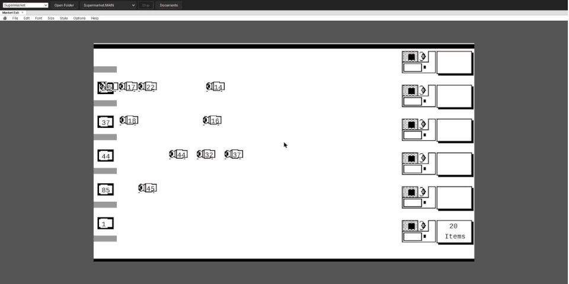

# ZBasic web interpreter

**▶ Run it in your browser: <https://rpmcruz.github.io/zbasic/>** — nothing to
install; the interpreter and the programs are static files served from this
repository by GitHub Pages and run entirely in your browser.



Interpreter for old ZBasic programs. ZBasic was a programming language from the 80s that was easy-to-use, cross-plataform, and had many GUI elements. The motivation for this interpreter was mainly to run [David D. Friedman's educational games](http://daviddfriedman.com/Living_Paper/living_paper.htm) to teach economics, which were probably the first educational games to be bundled together with a textbook.

## Try it

Each link opens the program and starts it:

| | |
|---|---|
| [**Supermarket**](https://rpmcruz.github.io/zbasic/?prog=Supermarket) | shoppers pick a checkout queue — watch how the search rule they use decides whether the lines balance; type an item limit into a checkout's box to make it an express lane |
| [**Price Theory**](https://rpmcruz.github.io/zbasic/?prog=MacPThy) | draw budget lines and indifference curves; close the instructions, then Control → BI Draw for the drawing tools |
| [**Curve Draw**](https://rpmcruz.github.io/zbasic/?prog=CDraw) | a function, its derivative and its average, drawn together — draw one with the mouse, or pick one from the f(x)= menu |
| [**Grglflx**](https://rpmcruz.github.io/zbasic/?prog=Grglflx) | guess where a wandering series goes next |

Or pick a program from the dropdown on the left and press Run.

Programs that save their work — Curve Draw's hand-drawn curves, Price Theory's
BI Draw screens — save it in your browser, through the same Open and Save
dialogs the Mac had; **Export** and **Import** in those dialogs move a
document to and from your computer.

## How to run it locally

Serve the directory over HTTP and open it, e.g.
`python3 -m http.server` and then <http://localhost:8000/>. Opening
`index.html` straight off the disk also works, but then the browser will not
let the page read `progs/programs.json`, so the program dropdown is hidden; use
**Open Folder** to load a program's directory instead (it works for any
directory of ZBasic sources).

## Building

node.js is only needed to build, never to run.

```sh
npm install pegjs
node zbasic-compile.js       # grammar → zbasic-compiled.js, and progs/programs.json
```

Run `zbasic-compile.js` after changing `zbasic.pegjs` or anything in `progs/`.

### Where the programs come from

The archives in `progs/*.sit` are the originals and the source of truth;
`progs/extracted/` is generated from them:

```sh
unar -k visible -o progs/extracted progs/*.sit   # -k visible keeps each resource fork as a .rsrc file
node zbasic-detokenize.js                         # tokenized ZBasic sources → *.detok.txt listings
node zbasic-compile.js
```

The resource forks (`.rsrc`) carry the programs' menus, windows, pictures,
alerts and help text. Each program also comes as ZBasic's own tokenized source
and, mostly, as a text listing. The listings are later exports and not always
faithful — CDraw's, from 2000, is half translated into another BASIC — so
`zbasic-detokenize.js` recovers a listing from the tokenized file, and a program
starts from the listing of the version its application was built from (see
`pickMain()` in `zbasic-compile.js`).

## Testing

```sh
node test-headless.js --all          # start every program and report errors or hangs
node test-headless.js Supermarket 20 # one program, for 20 s, with a summary of what it did
node test-headless.js test.bas 5     # any single ZBasic source file
node test-parser.js <file>           # dump one source file's AST
```

`test-headless.js` runs `index.html`'s interpreter in node against a stub DOM,
so it checks behaviour, not pixels; look at the result in a browser too.

## Layout

| | |
|---|---|
| `index.html` | the whole interpreter — parser driver, runtime, and the Mac UI |
| `zbasic.pegjs` | the grammar |
| `zbasic-compile.js` | build step: grammar → `zbasic-compiled.js`, plus `progs/programs.json` |
| `zbasic-compiled.js` | generated parser, loaded by `index.html` |
| `zbasic-detokenize.js` | turns ZBasic's tokenized source files back into text |
| `test-headless.js` | runs the programs headlessly |
| `test-parser.js` | dumps one file's AST |
| `progs/*.sit` | the original archives |
| `docs/` | the ZBasic manuals |
| `img/` | the animation at the top of this file |
| `CLAUDE.md` | notes for working on the interpreter |

`progs/extracted/DosPThy` is the DOS edition of Price Theory, written in
GW-BASIC rather than ZBasic; it is not runnable here.
